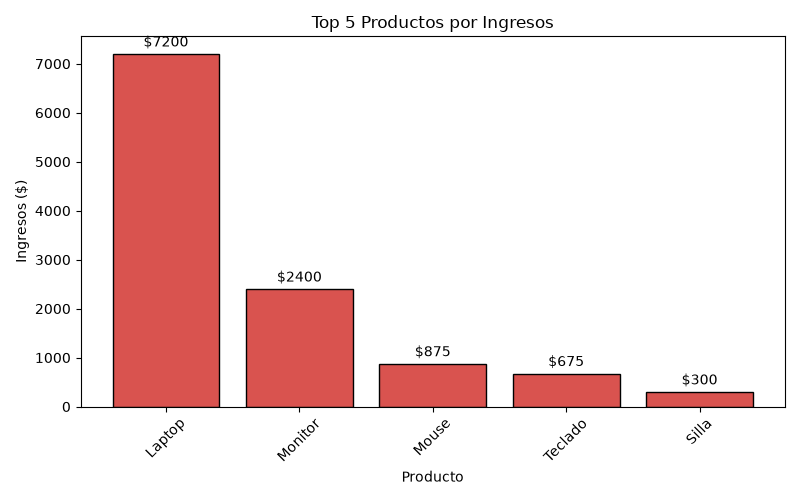
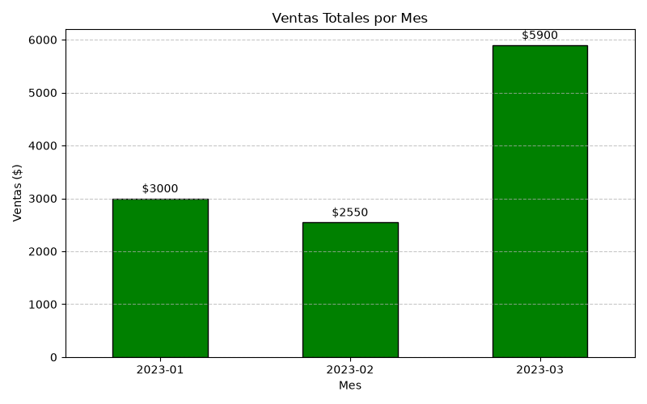

# Análisis de Ventas y Flujo ETL 📊

Este proyecto implementa un flujo automatizado utilizando **Pandas** y **Matplotlib** para procesar datos crudos y convertirlos en insights de negocio listos para análisis corporativo.

## 📈 Resultados Visuales

### Top 5 Productos por Ingreso

### Tendencia de Ventas Mensuales
